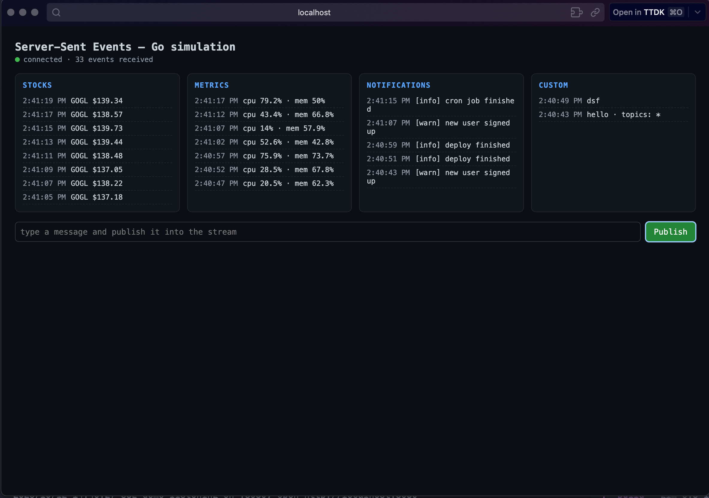

# Server-Sent Events (SSE) in Golang

## What is SSE

Server-Sent Events is a one-way streaming protocol over plain HTTP: the server pushes text frames to the client whenever it has new data, and browsers consume them with the built-in `EventSource` API. Compared to WebSockets it is much simpler — no protocol upgrade, just a long-lived `text/event-stream` response — at the cost of being one-directional (server → client). Reconnection is built in: on a dropped stream the browser reconnects on its own and replays the `Last-Event-ID` header so the server knows what the client last saw.

This simulation is self-contained on the stdlib `net/http` — no frameworks, no dependencies:

```
producer (goroutine) ─┐
producer (goroutine) ─┼─► Broker (non-blocking fan-out) ─► client inbox (chan, buffer 16) ─► SSE handler ─► ResponseWriter
POST /publish        ─┘
```

- **Broker** — a topic-based hub. Publishing never blocks: a slow client whose inbox channel is full simply gets its events dropped (counted in stats) instead of stalling every other subscriber. `Unsubscribe` closes a client's channel under the write lock, so it can never race with a `Publish` that is mid-send.
- **SSE handler** — sets the streaming headers, writes `retry: 3000` so the browser knows how long to wait before reconnecting, then loops over broker events, heartbeat ticks, and request cancellation. Topics are filtered server-side via `?topics=stocks,metrics`.
- **Simulated producers** — three goroutines that publish automatically, so there is always something to watch.



## Endpoints

| Endpoint   | Method | Description                                          |
| ---------- | ------ | ---------------------------------------------------- |
| `/`        | GET    | Browser demo page (EventSource API)                   |
| `/events`  | GET    | The SSE stream. Filter topics: `?topics=stocks,metrics` |
| `/publish` | POST   | Publish a custom event into the stream                |
| `/stats`   | GET    | Live client count, published/dropped events, uptime   |

Publish a manual event:

```bash
curl -X POST localhost:8080/publish \
  -H 'Content-Type: application/json' \
  -d '{"topic":"custom","type":"message","payload":{"text":"halo"}}'
```

Listen to the raw stream:

```bash
curl -N localhost:8080/events                      # all topics
curl -N 'localhost:8080/events?topics=stocks'      # one topic
```

Each event is one SSE frame — the `data:` line carries the full event JSON, with the payload nested under `payload`:

```
id: 42
event: price
data: {"id":42,"topic":"stocks","type":"price","payload":{"price":125.76,"symbol":"GOGL"},"at":"2026-10-12T01:26:26.78Z"}
```

## Simulated producers

- `stocks` — random-walk stock price every 2s (`event: price`)
- `metrics` — fake CPU/memory metrics every 5s (`event: metrics`)
- `notifications` — fake ops notifications every 8s (`event: notification`)

## Implementation notes

The parts that matter when running SSE for real in Go:

- **`WriteTimeout` must stay 0** on `http.Server` — a non-zero value silently kills long-lived streams. Timeouts are applied per write instead, via `http.NewResponseController` (`SetWriteDeadline` before every frame), so a stuck client can't block the server forever.
- **Heartbeats** — a `: ping` comment frame every 15s keeps proxies and load balancers from idle-killing the connection. Clients never see comment frames; `EventSource` ignores them.
- **Reconnect** — `retry:` + per-event `id:` enable the browser's auto-reconnect and `Last-Event-ID` replay (acknowledged in a comment frame).
- **Graceful shutdown** — `BaseContext` is tied to `signal.NotifyContext`, so Ctrl-C cancels every in-flight SSE request context and `srv.Shutdown` returns immediately instead of waiting on open streams forever.
- **Slow-client policy** — drop, don't block. One laggy tab must never be able to stall the fan-out for everyone else.

## Files

Everything lives in one `package main`, split by concern:

- `broker.go` — the `Event` type, the per-`client` inbox, and the `Broker` hub: subscribe/unsubscribe, non-blocking `Publish`, stats counters, ID sequence
- `server.go` — the `server` type, the route table, and the request-logging middleware
- `handlers.go` — the HTTP handlers (SSE endpoint, `/publish`, `/stats`, demo pages) plus the SSE frame writer and the `writeTimeout`/`heartbeatEvery` constants
- `simulators.go` — the three fake producers: stocks, metrics, notifications
- `index.go` — the browser demo page (embedded HTML + `EventSource` JS)
- `main.go` — entry point only: `-addr` flag, signal handling, `http.Server` setup, graceful shutdown

## Running it yourself

```bash
go run .             # default :8080
go run . -addr :9090
```

Then open http://localhost:8080 in a browser: three panels streaming live, a connection indicator, and a publish box that injects events into the same stream.
